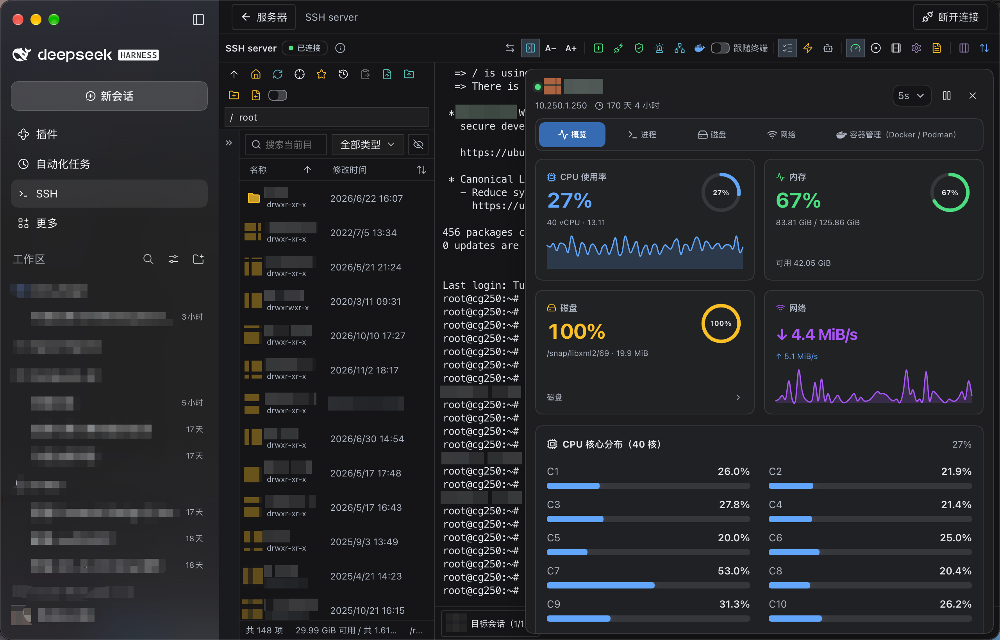

# DeepSeek Harness SSH 插件

在 DeepSeek Harness 中连接服务器，把终端、文件传输、服务器监控和 AI 运维放在同一个工作台里。

本项目基于 [jinpy666/dbx-plugin-ssh](https://github.com/jinpy666/dbx-plugin-ssh) 适配，复用其 Rust 后端和 Vue 终端工作台，并接入 Harness 的侧栏、连接管理与 Agent 工具服务。

[安装使用](#安装) · [Agent 自动化](#agent-自动化) · [配置与开发](docs/ADAPTATION.md) · [验证记录](docs/VALIDATION.md) · [上游项目](https://github.com/jinpy666/dbx-plugin-ssh)

## 先看效果



*在 Harness 侧栏打开 SSH，同时使用 SFTP、终端和 CPU、内存、磁盘、网络监控。*

## 可以用它做什么

| 场景 | 对应能力 |
| --- | --- |
| 日常巡检与问题排查 | 交互式终端、命令历史、快速命令、服务器指标与进程查看 |
| 管理远程文件 | SFTP 浏览、预览、上传、下载、重命名和目录管理 |
| 访问内网服务器 | 最多三跳 ProxyJump、连接保活和 Known Hosts 校验 |
| 控制运维权限 | 只读模式、sudo 配置、命令白名单和操作审计 |
| 自动化重复任务 | Harness Agent 复用已保存的连接，调用 SSH/SFTP 工具 |

## 核心能力

- **终端工作台**：PTY 交互终端、窗口调整、批量输入、快速命令、终端录制与远程目录跟随。
- **SFTP 文件管理**：文件浏览、排序、预览、传输进度与取消；支持文件选择器和拖放上传。系统剪贴板文件粘贴取决于宿主是否提供原生 `paste` 文件事件。
- **服务器监控**：CPU、内存、磁盘、网络趋势，以及进程、磁盘和容器管理面板。
- **连接与认证**：密码、私钥、SSH Agent 和自动认证，保留上游跳板机、TOTP、键盘交互和受控提权能力。
- **中文界面与主题**：创建连接的字段、说明和选项已中文化；私钥可通过「选择文件…」导入，工具栏与图表跟随 Harness 亮暗主题。
- **会话保留**：返回服务器列表后再次打开当前连接，或在 Harness 侧栏之间切换，可以回到原工作台。需要结束时点击「断开连接」。刷新页面或退出 Harness 会结束当前客户端会话。
- **Agent 与界面共享连接**：提供 16 个 SSH/SFTP 工具，支持在可见终端中执行 AI/MCP 命令，方便查看执行过程。

当前主要面向 SSH/SFTP 运维。Telnet、串口、VNC、实验性 RDP 等上游实现仍保留，兼容情况与尚未验收的功能见[验证记录](docs/VALIDATION.md)。

## 安装

需要已安装的 DeepSeek Harness。仓库自带构建好的客户端和 **macOS ARM64** 后端；其他平台需先下载匹配的后端。

### 1. 克隆仓库

```bash
git clone https://github.com/foryourever/ssh-plugin-dsh.git
cd ssh-plugin-dsh
```

macOS ARM64 可直接继续安装。其他平台需要 Node.js 22+ 和 Python 3，在仓库目录运行：

```bash
npm run setup:backend
```

脚本按当前平台下载锁定版本的官方后端，并校验 SHA-256。发布资产覆盖 macOS ARM64/x64、Linux x64/ARM64、Windows x64；当前运行验收环境为 macOS ARM64。

### 2. 安装到 Harness

在可调用 `plugin_manager` 的 Harness 会话中，让 Agent 安装本地插件目录，例如：

> 使用 plugin_manager 安装本地 bundle，目录是 /absolute/path/to/ssh-plugin-dsh。

对应工具参数如下，将 `target` 替换为克隆目录的**绝对路径**：

```json
{
  "action": "install_bundle",
  "target": "/absolute/path/to/ssh-plugin-dsh"
}
```

检查安装结果中的 `application` 和 `warnings`：`applied` 表示已应用，`restart-required` 表示需要重启对应 Harness 实例。

### 3. 打开 SSH 工作台

1. 点击 Harness 左侧 **SSH**。
2. 点击「添加服务器」，填写地址、端口、用户名和认证方式；私钥认证可点击「选择文件…」导入私钥。
3. 保存并连接，使用终端、SFTP、服务器监控和端口映射等功能。
4. 在 Harness 对话中让 Agent 使用已保存的连接执行任务。

插件启用后由 Harness 管理，无需每次手动启动后端。编辑连接时，留空已有密码可保留原值，勾选清除选项才会清空。

## Agent 自动化

直接在 Harness 中描述任务，Agent 可通过连接名称或 ID 使用已保存的服务器：

> 列出 SSH 服务器，连接“测试服务器”，查看磁盘使用情况和最近的错误日志。

> 将本地配置上传到测试服务器，读取上传后的文件并核对内容。

> 在测试服务器执行一个后台任务，然后查询任务状态。

当前固定后端版本实际注册 **16 个工具**：

| 类别 | 工具 |
| --- | --- |
| 命令与终端 | `ssh_exec`、`ssh_exec_sudo`、`ssh_multi_exec`、`ssh_terminal_input` |
| 后台任务与连接 | `ssh_run_bg`、`ssh_task_status`、`ssh_close`、`ssh_list_connections` |
| 主机指纹 | `ssh_list_known_hosts`、`ssh_remove_known_host` |
| SFTP | `sftp_list_dir`、`sftp_stat`、`sftp_upload`、`sftp_download`、`sftp_read_file`、`sftp_write_file` |

工具数量以运行时清单为准。上游只读限制、危险命令检查、连接范围和 sudo 白名单继续生效。建议在服务器表单中保存凭据，让 Agent 引用连接，避免在对话中粘贴密码或私钥。

## 数据与安全

- 连接数据默认保存在 `~/.dsh-ssh/default`；不同 `DSH_PROFILE` 使用不同子目录，也可通过 `DSH_SSH_DATA_DIR` 或插件 `dataDir` 配置指定位置。
- 连接内容使用 AES-256-GCM 加密存储。密钥与密文都保存在本机数据目录，应一起备份；这不能隔离具有同一系统账户权限的进程。
- Known Hosts、只读模式及 sudo 命令白名单沿用上游实现。插件不自动导入现有 DBX 应用中的连接。
- 取消、超时或删除服务器可能重启整个后端，关闭其他活动会话；已被远端接受的命令可能继续运行。详细行为见[配置与维护说明](docs/ADAPTATION.md#数据与配置)。

## 常见问题

### 后端已启用，但左侧没有 SSH 入口

在 DeepSeek Harness Desktop `0.2.1-rc.5` 中，新插件可能已在后端运行，但页面仍使用桌面进程启动时的前端清单。先完成当前任务，再 **⌘Q 完整退出 Harness 并重新打开**；只关闭窗口或刷新页面可能无法更新清单。重新打开后查看 SSH 入口。

### 更新后如何加载新界面

使用本地目录安装时，先在仓库中 `git pull`，再按安装结果处理重新加载或重启。已加载的页面需要刷新才能使用新客户端；请先完成当前操作，刷新会结束当前连接。旧版启动错误和历次修复见[维护说明](docs/ADAPTATION.md)。

### 浏览器文件操作与 DBX 桌面版有什么区别

上传、下载与文件选择使用浏览器提供的能力，受宿主授权和内存限制。选择私钥文件会导入内容，保存后加密存储，不会把浏览器虚拟路径当成本机路径。不能假定支持 DBX 原生桌面的任意本机路径操作或流式落盘。

## 开发与验证

开发需要 Node.js 22+；下载后端需要 Python 3，从源码编译后端另需 Cargo 与平台构建依赖。

```bash
npm install --ignore-scripts
npm --prefix frontend install --ignore-scripts
npm run setup:backend
npm run build
npm run check
npm run check:harness
npm run pack:bundle
```

`check:harness` 需要本机已安装 Harness。正式分发包使用 `pack:bundle` 生成，输出到 `dist/`。前端类型检查、测试命令、平台构建和验证边界见[配置与开发](docs/ADAPTATION.md)及[验证记录](docs/VALIDATION.md)。构建和测试不会自动安装插件或修改用户的 Harness profile。

## 来源与许可

感谢 [jinpy666/dbx-plugin-ssh](https://github.com/jinpy666/dbx-plugin-ssh) 提供的终端工作台与后端实现。本项目固定使用上游 **0.7.13-beta.1**，提交 `93c0c80cabffb08eec8fae4f7cfc0ed657ce8e9b`，并在 [original/](original/README.md) 中保留用户提供的全部 **1912 个原始文件**。来源与校验信息见 [UPSTREAM.json](UPSTREAM.json) 和[发布锁定清单](upstream-release-lock.json)。

本项目采用 **MIT** 许可，保留上游版权声明及第三方依赖的许可和归属。详见 [LICENSE](LICENSE)、[NOTICE](NOTICE)、[原版许可](original/LICENSE)与[第三方依赖清单](THIRD_PARTY_NPM.json)。

这是面向 DeepSeek Harness 的独立适配项目，不代表上游作者或 DeepSeek 官方发布。
